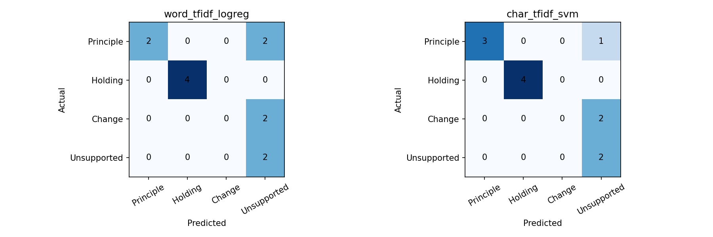
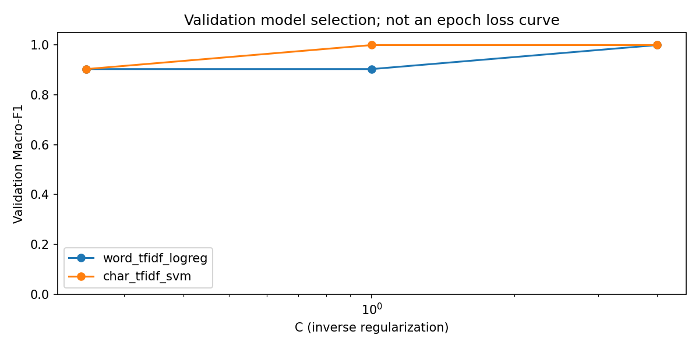

# 머신러닝 기반 투자정보 질의응답 시스템

워런 버핏의 공개 투자 원칙과 Berkshire Hathaway의 SEC Form 13F 보유 기록을 활용하여, 사용자의 질문을 분류하고 관련 근거를 제시하는 질의응답 시스템을 개발하였다. 단어 TF-IDF와 Logistic Regression을 결합한 베이스라인, 문자 TF-IDF와 Linear SVM을 결합한 비교 모델을 직접 학습하고 동일한 독립 테스트셋에서 평가하였다.

## 0. 프로젝트정보

| 항목 | 내용 |
|---|---|
| 과목 | 기계학습프로그래밍 기말 프로젝트 |
| 학번·이름 | 202234561 김은기 |
| 프로젝트명 | 워런 버핏의 투자 원칙과 실제 보유 기록을 활용한 근거 기반 AI 페르소나 챗봇 |
| 데이터 유형 | 한국어 질문 텍스트·SEC 공시 표형 데이터 |
| 학습 방식 | TF-IDF 특징과 지도학습 분류기의 스크래치 학습 |
| 최종 모델 | 단어 TF-IDF + Logistic Regression |
| GitHub | [eg-log/investment-qa](https://github.com/eg-log/investment-qa) |
| 서비스 | Colab 질의응답 실행 기록 보유. 상시 공개 서비스 URL 미확정 |

핵심 소스와 실행 결과는 [project.ipynb](project.ipynb)에 수록하였다. 학습 가중치, 평가 결과, 근거 데이터는 각각 [models](models/README.md), [평가 분석](docs/EVALUATION.md), [데이터 설명](data/README.md)에서 확인할 수 있다.

## 1. 문제정의

| 요소 | 정의 |
|---|---|
| Who | 투자자의 공개 원칙과 기관 보유 기록을 이해하려는 일반 사용자 및 투자 학습자 |
| What | 질문을 투자 원칙·보유 현황·보유 변화·확인 불가의 네 유형으로 분류하고 해당 근거를 제시 |
| When | 2025년 1·2분기 보유 기록을 비교하거나 공개 투자 원칙을 학습할 때 |
| Why | 주주서한과 SEC 공시에 분산된 자료를 질문의 목적에 맞게 확인하기 위해 |

핵심 차별점은 **일반적인 투자 원칙과 기관의 공시상 보유 사실을 구분하는 근거 제시 방식**이다. 투자 원칙이 특정 거래의 실제 동기라는 인과관계는 가정하지 않는다. 13F는 분기 말 보유 상태이므로 버핏 개인의 거래나 거래 체결일을 나타내는 자료로 사용하지 않는다.

정량 목표는 **독립 테스트셋 Macro-F1 0.80 이상**으로 설정하였다. 실제 결과는 Logistic Regression 0.5417, Linear SVM 0.6071로 목표에 미달하였다. 서비스는 투자정보 학습을 위한 프로토타입이며, 실제 인물의 새로운 발언이나 주가 전망을 생성하는 모델로 설계하지 않았다.

## 2. 데이터

### 자료 출처와 선정 이유

| 자료 | 출처·수집 범위 | 이용·검수 상태 | 선정 이유 |
|---|---|---|---|
| SEC Form 13F | 작성자가 SEC에서 다운로드한 2025년 3~5월·6~8월 제출분 ZIP 2개 | 공식 공개 자료. 별도 재배포 라이선스는 확인되지 않았으며 원본 ZIP은 저장소에 포함하지 않음 | 기관·보고 기준일·증권 식별자로 보유 사실을 추적할 수 있음 |
| Berkshire 주주서한 | 2020~2024 보고연도 자료에서 정리한 원칙 요약 14개 | 원문 전체 대신 한국어 의역과 출처를 수록. AI 보조 초안의 독립 수동 검수는 미완료 | 보유 공시에 포함되지 않는 공개 투자 원칙을 별도 근거로 제공 |
| 질문 데이터 | 공시 사실과 투자 원칙에 연결한 한국어 질문 초안 96개 | AI 보조 작성 사실을 검수 상태 필드에 표시 | 사실·원칙·보유 변화·확인 불가를 구분하는 지도학습 과제 구성 |

공식 출처: [SEC Form 13F 데이터셋](https://www.sec.gov/data-research/sec-markets-data/form-13f-data-sets), [Berkshire Hathaway 주주서한](https://www.berkshirehathaway.com/letters/letters.html). 주주서한의 보고연도와 발행연도는 구분하여 기록하였다. 원문에 별도 이용 조건이 있는 경우 해당 조건이 적용된다.

### 데이터 규모와 구성

SEC 원본 INFOTABLE은 각각 **3,440,002행·3,360,306행**이다. CIK `0001067983`과 기관명, 보고 기준일을 확인하여 Berkshire Hathaway의 공시 3건에서 228행을 추출하였다. 이를 집계한 분기별 증권 보유 기록은 80건이며, 두 분기 비교 대상 증권은 42건이다. 보고 기준일은 **2025-03-31·2025-06-30**으로, ZIP의 제출 기간과 구분된다.

서비스 근거 집합은 **139건**이다. 구성은 원칙 14건, 증권 보유 80건, 보고 기간별 공시 근거 2건, 보유 변화 42건, 자료 범위 설명 1건이다. [knowledge.json](models/knowledge.json)에 사실·출처·근거 유형을 함께 저장하였다.

| 질문 유형 | Train | Validation | Test | Development | 합계 |
|---|---:|---:|---:|---:|---:|
| INVESTMENT_PRINCIPLE | 21 | 9 | 4 | 6 | 40 |
| HOLDING_FACT | 12 | 2 | 4 | 2 | 20 |
| HOLDING_CHANGE | 12 | 2 | 2 | 2 | 18 |
| UNSUPPORTED | 12 | 2 | 2 | 2 | 18 |
| **합계** | **57** | **15** | **12** | **12** | **96** |

주 평가 자료는 train·validation·test의 84개이며 development 12개는 별도 개발 점검 자료이다. 실제 분할 자료는 [data/dataset](data/dataset)에 수록하였으며 최종 모델의 `split_sha256`과 일치한다. 데이터 규모가 작고 하나의 기관·두 분기에 한정되어 있다는 한계가 있다.

## 3. 데이터전처리

전처리 코드는 노트북의 SEC 자료 정형화 부분에 수록하였다. 주요 처리와 실제 전후 결과는 다음과 같다.

| 처리 | 처리 전 | 처리 후·검증 결과 |
|---|---|---|
| 기관·기간 필터링 | 두 INFOTABLE 총 6,800,308행 | Berkshire Hathaway 대상 공시 3건·228행 선택 |
| 수정 공시 반영 | 1분기 원본 공시 110행 | `NEW HOLDINGS` 4행을 추가하여 114행 확정 |
| 결측값 처리 | 선택 필드의 빈 문자열 | 456개를 null로 통일 |
| 수치·식별자 처리 | 문자열 수치와 증권 식별자 | 수치 필드 1,140개 파싱, CIK·CUSIP·공시번호는 문자열 유지 |
| 증권별 집계 | 두 분기 보유 원시 행 228개 | 분기별 증권 보유 80건으로 집계 |

중복 기본키 제거와 문자열 정규화 검사를 수행하였으나 실제 변경은 각각 **0건**이었다. 수정 공시를 일괄 대체하거나 무조건 합산하지 않고 수정 유형을 구분하였다. 주식 수량·원금 표시 및 PUT/CALL 등 증권 유형도 구분하여 집계하였다.

분기 비교 라벨은 유지 24건·증가 8건·감소 6건·신규 3건·미신고 전환 1건이다. 미신고 항목은 비교 계산에서 0으로 처리하였으며, 이를 기관의 전체 보유가 0이라는 사실이나 특정인의 직접 매도로 해석하지 않는다. 기업 분할·합병·식별자 변경에 대한 검증은 미완료이다.

난수 시드는 **42**이다. 주 평가 자료의 실제 train/validation/test 비율은 **67.86/17.86/14.29%**이다. 원칙 의미군과 증권 단위로 그룹을 구성하고, 최종 시험 전용 그룹을 분리하였다. 그룹·질문 ID·공백 정규화 질문의 분할 간 중복 검사를 통과하였다. 다만 원문 문서와 보고 기간을 공유하므로 새로운 문서·시점에 대한 일반화 성능까지 검증한 것은 아니다.

## 4. 모델

| 항목 | 베이스라인 | 제안·비교 모델 |
|---|---|---|
| 모델 | 단어 TF-IDF + Logistic Regression | 문자 TF-IDF + Linear SVM |
| 특징 | 단어 1~2그램 | 문자 2~5그램 |
| 학습 방식 | 지도학습, class_weight=balanced | 지도학습, class_weight=balanced |
| 정규화 후보 C | 0.25, 1.0, 4.0 | 0.25, 1.0, 4.0 |
| 최대 최적화 반복 수 | 2,000 | 5,000 |
| 난수 시드 | 42 | 42 |
| 선정 이유 | 해석과 실행이 간단한 CPU 기반 질문 분류 기준 | 부분 문자열과 한국어 표현에 대한 분류 성능 비교 |

분류기의 TF-IDF 어휘와 분류 계수는 train 57개로 학습하였다. 각 모델의 C를 validation 결과로 선택하고 두 모델을 동일한 테스트 12개에서 평가하였다. 검색기는 평가 질문·모범 답안 대신 공개 근거의 검색 텍스트로 구성하였다.

최종 모델 선정 기준은 **검증 Macro-F1 → 검증 Accuracy → 동률 시 베이스라인**이다. 두 모델의 검증 최고 성능이 모두 1.0이므로 최종 서비스 모델은 `word_tfidf_logreg`로 결정하였다. 테스트 결과가 더 높은 SVM으로 사후 변경하지 않았다. [학습 로그](models/training_log.json), [선정 결과](models/selection.json), [모델 파일 구성](models/README.md)

## 5. 평가결과

| 모델 | Test Macro-F1 | Accuracy | Macro-Precision | Macro-Recall | 근거 Recall@3 |
|---|---:|---:|---:|---:|---:|
| 단어 TF-IDF + Logistic Regression | 0.5417 | 0.6667 | 0.5833 | 0.6250 | 0.60 |
| 문자 TF-IDF + Linear SVM | 0.6071 | 0.7500 | 0.6000 | 0.6875 | 0.70 |

Macro 지표는 네 클래스를 동일한 비중으로 평균하였다. 근거 Recall@3는 확인 불가 질문을 제외한 테스트 10개에서 정답 근거가 상위 3개 결과에 포함된 비율을 평균한 값이다. 이는 질문 분류·보호 규칙·근거 조회를 포함한 전체 파이프라인의 지표이다. [원시 평가 결과](models/test_results.json), [비교표 CSV](models/comparison.csv), [근거 평가 기록](reports/evidence_results.json)

### 혼동행렬



Logistic Regression은 12문항 중 8개, SVM은 9개를 맞혔다. 두 모델 모두 HOLDING_CHANGE의 테스트 2문항을 UNSUPPORTED로 분류하여 해당 클래스의 F1이 0으로 나타났다. 원칙 질문 중 시장 가격·사업 가치 구분 문항도 두 모델이 모두 오분류하였다.

### 정규화 강도와 검증 성능



위 그림은 C 후보별 검증 성능 비교이며 에포크별 손실 곡선은 아니다. 검증 최고 Macro-F1 1.0과 테스트 성능의 차이는 작은 검증셋에서 얻은 성능이 새로운 질문 표현으로 충분히 일반화되지 않았음을 보여준다. [오류 사례 7건](reports/error_cases.json)과 [상세 평가 해석](docs/EVALUATION.md)에 모델별 차이를 정리하였다.

정량 목표 F1 0.80은 달성하지 못하였다. 소규모 시험 자료의 변동성과 질문 초안의 검수 상태를 고려하여 결과를 해석해야 한다.

## 6. 서비스프로토타입

서비스는 **질문·대화 맥락 → 학습한 질문 분류기 → 종목·기간·유형에 맞는 근거 조회 → 템플릿 답변과 출처 표시**로 동작한다. 머신러닝 모델의 역할은 질문 유형 분류이며, 답변 문장 구성은 검색 결과와 템플릿이 담당한다.

[app.py](app.py)는 저장 모델을 검사한 뒤 [persona_runtime.py](persona_runtime.py)의 Gradio 화면을 실행한다. 모델과 검색기는 `.joblib`, 근거는 `knowledge.json`에서 로드한다. 모델을 새로 학습하거나 외부 생성형 AI API를 호출하는 과정은 서비스 실행에 포함하지 않는다.

구현 기능은 질문 입력, 예측 유형·근거 ID·공식 출처 표시, 종목·기간을 이어받는 후속 질문, 대화 초기화, 1~800자 입력 검증이다. 확인되지 않은 매매 동기·개인 계좌·미래 주가 질문은 자료 범위 보호 규칙을 적용한다.

| Colab 실행 사례 | 기록된 결과 |
|---|---|
| 장기투자 원칙 질문 | 원칙 근거 P2020_1·P2021_1·P2022_1 제시 |
| 2025년 1분기 애플 보유량 | 300,000,000주 |
| 후속 질문 “그럼 2분기는요?” | 애플 맥락을 유지하여 280,000,000주 조회 |
| 컨스텔레이션 분기 변화 | 12,009,000주 → 13,400,000주, 차이 +1,391,000주 |
| “왜 애플을 매수했나요?” | 확인 불가 응답과 SCOPE_13F 근거 제시 |

위 사례는 [Colab 질의응답 기록](reports/service_smoke.json)에 저장되어 있다. 시연 질문 일부는 학습 자료에 포함되어 있으므로 독립 테스트 성능과 구분한다. 공개 배포 화면 캡처는 현재 미수록이다.

## 7. 배포

배포 대상은 **Cloudflare Workers + Containers**이다. Worker가 요청을 하나의 Durable Object에 전달하고, Durable Object가 Python 컨테이너의 Gradio 서버에 연결한다. 컨테이너에서는 기존 Logistic Regression 모델과 근거 데이터를 로드하며 전처리·학습은 수행하지 않는다.

`Dockerfile`은 Python 3.13 환경과 기존 의존성을 구성한다. `serve_container.py`는 기존 Gradio 앱을 **0.0.0.0:7860**에서 실행한다. `wrangler.jsonc`의 `workers_dev: true` 설정에 따라 최종 URL은 실제 배포 결과의 **workers.dev 도메인**을 사용한다.

| 검증 범위 | 상태 |
|---|---|
| Colab 학습·평가·질의응답 | 실행 출력 및 저장 산출물 보유 |
| 모델·근거 파일 무결성 | 검증 완료 |
| GitHub 공개 소스 | [eg-log/investment-qa](https://github.com/eg-log/investment-qa) |
| 컨테이너 배포 파일·Workers 프록시 | 구성 완료, 프록시 헬퍼 단위 검사 통과 |
| Docker 이미지 빌드·실제 HTTP 질의응답 | 미실행 |
| Cloudflare 원격 배포·외부 예측 | 미실행·공개 URL 미확정 |

동일 컨테이너로 요청을 전달하여 Gradio 큐와 후속 질문 상태를 유지한다. 컨테이너 시작 시 HTTP 준비 상태를 확인하고 SSE 응답을 스트리밍으로 전달한다. 5분 유휴 중지·재배포 시 메모리의 대화 상태는 초기화되며 저장 가중치는 다음 시작 시 다시 로드된다.

Workers Paid 플랜과 사용량 과금이 적용되는 구성이다. 계정 인증·플랜 활성화·결제·실제 배포는 아직 실행하지 않았다. [Cloudflare 구성 및 실행 절차](docs/CLOUDFLARE.md), [산출물 검증 범위](docs/VALIDATION.md)

## 8. 실행방법

학습 환경은 Python 3.13.18, pandas 2.2.3, NumPy 2.4.6, scikit-learn 1.6.1, joblib 1.6.0이다. 배포 의존성은 [requirements.txt](requirements.txt)에 고정하였다. Gradio 6.32.0은 서비스 배포용 버전이며 학습 당시의 정확한 Gradio 패치 버전은 실행 출력에 남아 있지 않다.

저장소 루트에서 다음 명령을 실행한다.

```bash
python -m pip install -r requirements.txt
python scripts/check_package.py
python scripts/smoke_test.py
python app.py
```

로컬 접속 주소는 `http://127.0.0.1:7860`이다. 가중치 경로는 기본 `models/`이며 `BUFFETT_MODEL_DIR`로 다른 경로를 지정할 수 있다. 현재 저장소에는 모델과 근거 파일이 포함되어 있으므로 추론에 SEC 원본 ZIP 업로드나 재학습은 필요하지 않다.

컨테이너 실행은 다음 명령을 사용한다. Docker 엔진이 실행되어 있어야 한다.

```bash
docker build --platform linux/amd64 -t investment-qa .
docker run --rm --name investment-qa-local -p 127.0.0.1:7860:7860 investment-qa
```

Wrangler는 Node.js 22 이상이 필요하며 제공된 GitHub Actions 구성은 Node.js 24를 사용한다. [package.json](package.json)의 `npm run check`와 `npm test`로 JavaScript 구문 및 프록시 검사를 수행한다. 계정·플랜 설정 후 `npm install`과 `npm run deploy`로 이미지와 Worker를 배포한다.

전체 데이터 정형화·학습 재현은 [project.ipynb](project.ipynb)의 `train` 모드에서 SEC 원본 ZIP 두 개를 입력하여 수행한다. 노트북의 `inference` 모드는 저장한 모델 폴더 또는 학습 결과 ZIP을 로드한다. [검토 자료 목록](docs/README.md)

## 9. Lessons Learned

### Plus

- **수정 공시의 유형을 반영하였다.** 1분기 원본 110행에 추가 공개 4행을 적용하여 114행을 확정하고, 기관 보유 사실과 계산된 변화를 구분하였다.
- **모델 선택과 테스트 평가를 구분하였다.** 같은 분할에서 두 모델을 학습하고, 검증 동률 시 베이스라인을 선택하는 규칙을 테스트 결과와 독립적으로 유지하였다.

### Minus

- **평가 자료가 작았다.** 테스트가 12문항에 불과하여 문항 하나의 오류가 Accuracy를 약 8.33%p 변화시킨다. HOLDING_CHANGE의 F1이 0으로 나타나 해당 유형의 일반화가 부족하였다.
- **질문과 원칙의 검수 범위가 제한적이었다.** AI 보조로 작성한 원칙 의역과 질문 초안의 독립 수동 검수가 완료되지 않아 실제 사용자 표현과 원문 의미를 추가 대조할 필요가 있다.

### Interesting

- **검증 성능의 동률이 테스트 성능의 동률을 뜻하지 않았다.** 두 모델의 검증 최고 F1은 1.0이지만 독립 테스트 F1은 0.5417과 0.6071로 달랐다.
- **보유 기준일과 공개 시점이 달랐다.** 2025년 3월 31일 보유분에 관한 추가 공시가 8월 14일 제출되어, 분기 말 보유 상태와 자료가 공개된 시점을 구분해야 했다.

### 문제 해결 사례

**문제:** 1분기 원본 공시 외에 추가 공개 공시가 존재하여 분기 비교에 사용할 보유 집합을 확정해야 했다.

**원인:** `13F-HR/A`의 `AMENDMENTTYPE`이 `NEW HOLDINGS`였으며 원본과 다른 4개 행을 포함하였다.

**시도:** 공시번호로 테이블을 연결하고 수정 유형을 확인하여, 정정과 추가 공개를 구분하는 처리 규칙을 적용하였다.

**결과:** 1분기 110행에 4행을 반영하여 114행을 확정하였다. 두 분기의 228행을 증권 단위 80건으로 집계한 과정과 전후 행 수를 노트북 출력으로 확인하였다.

### 개선 계획

- 데이터: 원칙 의역을 공식 원문과 수동 대조하고 새로운 사용자 표현·기관·분기를 포함하는 독립 평가 자료를 확충한다.
- 모델: 보유 변화 질문의 오분류를 분석하고 분류와 근거 조회의 오류를 분리하여 개선 효과를 평가한다.
- 서비스: 공개 배포 환경에서 응답 시간·재시작·후속 질문·입력 오류를 검증하고 실제 화면과 접속 기록을 남긴다.
