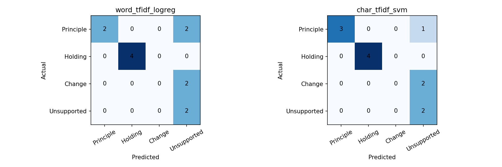
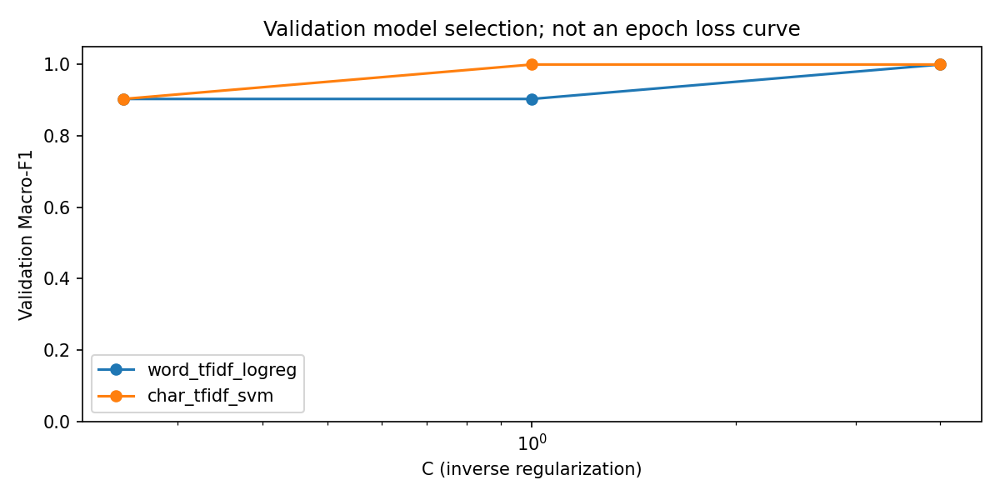

# 모델 평가 방법과 결과 분석

## 1. 평가 설계

평가 대상은 INVESTMENT_PRINCIPLE·HOLDING_FACT·HOLDING_CHANGE·UNSUPPORTED의 네 클래스 질문 분류이다. train 57개로 학습하고 validation 15개로 C 후보 및 최종 모델을 선택한 뒤 독립 test 12개에서 비교하였다. development 12개는 별도 개발 점검 자료이다. 최종 실행은 `runs/20261119_115608_098551`이다.

원칙 의미군과 증권 단위를 그룹화하고 최종 시험 그룹을 별도로 지정하였다. 난수 시드는 42이다. 원문 문서와 보고 기간은 분할 간 공유되므로 이 평가를 새로운 문서·기관·시점 전체에 대한 성능으로 확대 해석하지 않는다.

## 2. 지표 정의

| 지표 | 계산 방식·대상 |
|---|---|
| Macro-F1 | 네 클래스의 F1을 같은 비중으로 평균. zero_division=0 |
| Accuracy | 전체 테스트 문항 중 정답 클래스와 예측 클래스가 같은 비율 |
| Macro-Precision·Recall | 네 클래스의 Precision·Recall을 각각 같은 비중으로 평균 |
| 근거 Recall@3 | 확인 불가 문항을 제외한 10개에서 정답 근거 ID와 반환 근거 ID의 교집합 크기를 정답 근거 수로 나눈 뒤 평균 |

근거 Recall@3에는 질문 분류·범위 보호 규칙·근거 조회의 결과가 함께 반영된다. 분류 지표와 근거 검색 지표는 다른 측정 대상이며, 어느 하나만으로 최종 답변의 정확성 전체를 보장하지 않는다.

## 3. 검증 기준 모델 선택

| 모델 | C | Train Macro-F1 | Validation Macro-F1 | Validation Accuracy |
|---|---:|---:|---:|---:|
| 단어 TF-IDF + LR | 0.25 | 1.0000 | 0.9035 | 0.9333 |
| 단어 TF-IDF + LR | 1.0 | 1.0000 | 0.9035 | 0.9333 |
| 단어 TF-IDF + LR | 4.0 | 1.0000 | 1.0000 | 1.0000 |
| 문자 TF-IDF + SVM | 0.25 | 1.0000 | 0.9035 | 0.9333 |
| 문자 TF-IDF + SVM | 1.0 | 1.0000 | 1.0000 | 1.0000 |
| 문자 TF-IDF + SVM | 4.0 | 1.0000 | 1.0000 | 1.0000 |

모델별 최고 검증 성능을 비교하고 동률이면 베이스라인을 사용하는 규칙에 따라 Logistic Regression을 최종 선택하였다. 테스트 점수는 선택에 사용하지 않았다. 위 값과 최적화 반복 수·실측 학습 시간은 [학습 로그](../models/training_log.json)에 저장되어 있다.

## 4. 독립 테스트 결과

| 모델 | Macro-F1 | Accuracy | Macro-Precision | Macro-Recall | 근거 Recall@3 |
|---|---:|---:|---:|---:|---:|
| 단어 TF-IDF + LR | 0.5417 | 0.6667 | 0.5833 | 0.6250 | 0.60 |
| 문자 TF-IDF + SVM | 0.6071 | 0.7500 | 0.6000 | 0.6875 | 0.70 |

정량 목표인 Macro-F1 0.80은 두 모델 모두 미달하였다. Accuracy는 각각 8/12, 9/12에 해당한다. SVM의 시험 성능이 더 높았으나, 검증 기준을 시험 결과에 맞추어 변경하지 않았다.

### 클래스별 F1

| 클래스 | 단어 TF-IDF + LR | 문자 TF-IDF + SVM | Test 지원 문항 수 |
|---|---:|---:|---:|
| INVESTMENT_PRINCIPLE | 0.6667 | 0.8571 | 4 |
| HOLDING_FACT | 1.0000 | 1.0000 | 4 |
| HOLDING_CHANGE | 0.0000 | 0.0000 | 2 |
| UNSUPPORTED | 0.5000 | 0.5714 | 2 |

정답 UNSUPPORTED의 재현율이 높아도 다른 유형을 UNSUPPORTED로 잘못 보내면 정밀도가 낮아진다. 답변 제한이 존재한다는 사실과 질문 분류의 적절성은 별도로 평가해야 한다.

## 5. 그래프와 오류 사례

행은 정답, 열은 예측이다. 표시 순서는 Principle·Holding·Change·Unsupported이다. 두 모델은 보유 변화 문항 2개를 모두 Unsupported로 분류하였다.

위 그림은 정규화 강도별 검증 성능이다. 학습 시간이나 최적화 반복 수를 에포크별 손실 기록으로 해석하지 않는다.

| 문항 | 정답 | 관찰된 오류 |
|---|---|---|
| Q038: 기관 투자자에게만 먼저 정보를 전달하는지에 관한 원칙 | INVESTMENT_PRINCIPLE | LR이 UNSUPPORTED로 예측, SVM은 정답 |
| Q040: 시장 가격과 사업 가치 구분 | INVESTMENT_PRINCIPLE | 두 모델 모두 UNSUPPORTED로 예측 |
| Q091: 코카콜라의 분기별 신고 수량 변화 | HOLDING_CHANGE | 두 모델 모두 UNSUPPORTED로 예측 |
| Q095: 셰브론의 분기별 신고 수량 변화 | HOLDING_CHANGE | 두 모델 모두 UNSUPPORTED로 예측 |

LR 4건·SVM 3건의 오류를 [error_cases.json](../reports/error_cases.json)에 수록하였다. 검증 점수가 높은 것과 별개로 원칙·보유 변화 질문의 새로운 표현에 대한 일반화가 제한적이었다.

## 6. 해석 범위

테스트 12문항에서는 한 문항의 차이가 Accuracy 약 8.33%p에 해당한다. 원칙 요약과 질문 자료에는 AI 보조 작성 초안이 포함되어 있으며 독립 수동 검수가 미완료이다. 또한 일부 시연 질문은 학습 자료에 포함되어 있다. 따라서 Colab 시연 성공을 독립 평가 결과에 더하여 성능을 높게 산정하지 않는다.

후속 연구에서는 검수된 실제 사용자 질문을 확충하고, 새로운 원칙 문서·기관·시점의 평가 자료를 분리하여 검증할 필요가 있다.
